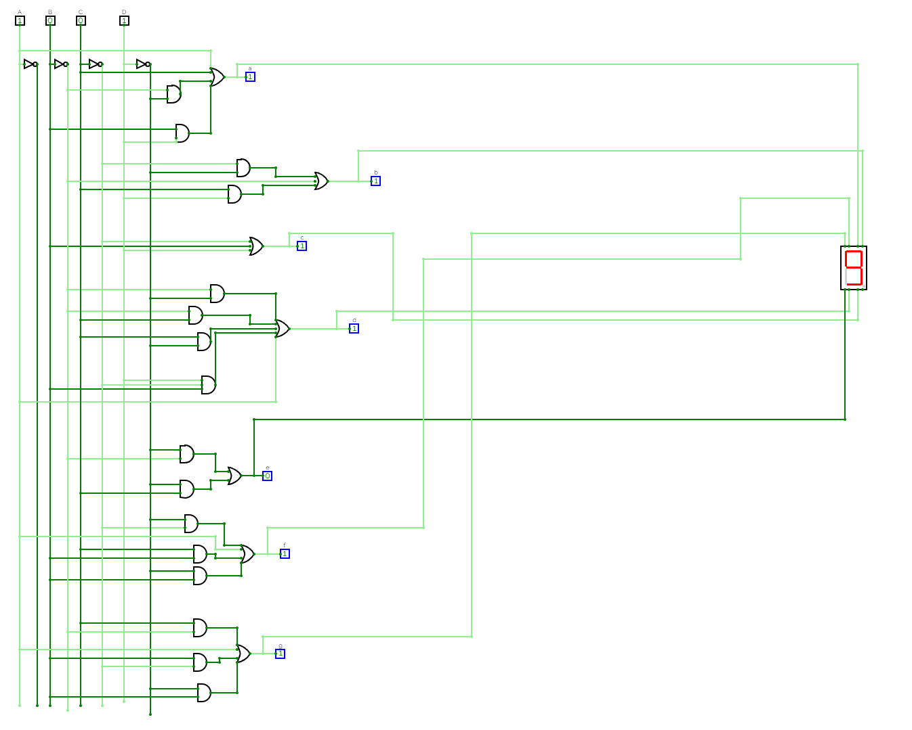

# BCD to Seven-Segment Decoder

**Digital logic · Boolean algebra · CircuitVerse**

A first-year digital logic design project that maps a four-bit BCD input to the seven segments needed to display decimal digits 0–9.

## Project contents

- [CircuitVerse project](circuit/bcd-seven-segment.cv) — the original editable circuit
- [Design notes](docs/design-notes.md) — inputs, outputs, and design process
- [Karnaugh maps and circuit images](docs/images/) — illustrations extracted from the original team report

## Design approach

The project starts with a digit-to-segment truth table, simplifies segment functions with Karnaugh maps, and implements the resulting logic with NOT, AND, and OR gates. Four labeled inputs, A–D, drive segment outputs a–g and a seven-segment display.

## Open the circuit

1. Download `circuit/bcd-seven-segment.cv`.
2. Open the [CircuitVerse simulator](https://circuitverse.org/simulator).
3. Use the simulator's project import/open-file option to load the `.cv` file.
4. Toggle the inputs and inspect the individual segment outputs and display.

The file has been checked as valid JSON with four inputs and seven labeled outputs. It has not been rerun in the simulator during portfolio preparation. The decimal design range is 0–9; inputs 10–15 are outside that range.

## Team

The original report credits **Mohamed Hesham, Ramy Slait, Mohamed Hany Kotb, and Fouad Khaled**. This repository presents the team's coursework with those credits preserved.
