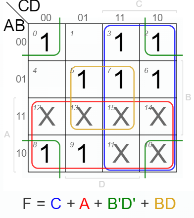
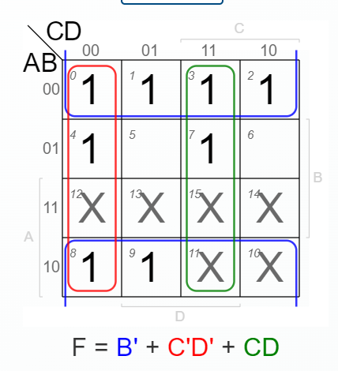
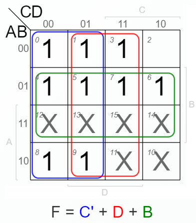
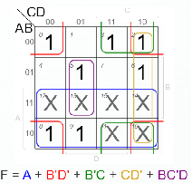
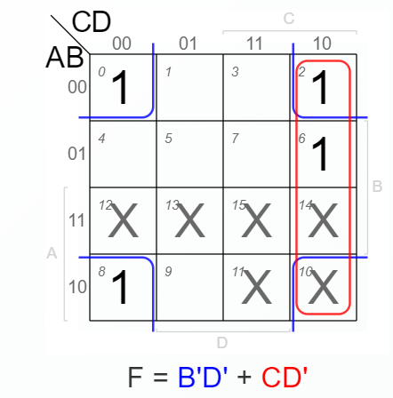
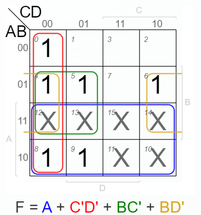
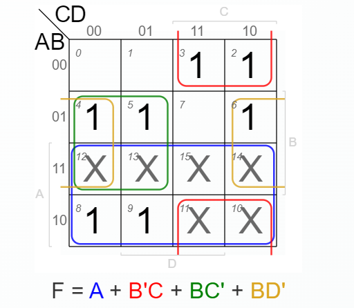

# Design notes

## Inputs and outputs

The circuit contains four binary inputs labeled A, B, C, and D, seven outputs labeled a–g, and a seven-segment display. Decimal values 0–9 are the intended BCD input range.

## Method

1. Identify which display segments are lit for each decimal digit.
2. Construct each segment's Boolean output function.
3. Use a Karnaugh map for each output to simplify its function.
4. Build the resulting combinational circuit in CircuitVerse.
5. Compare the displayed digit with the selected BCD input.

## Original design illustrations

These illustrations and the circuit schematic are extracted from the team's original report. The editable `.cv` file is the source of record for the implemented circuit.
